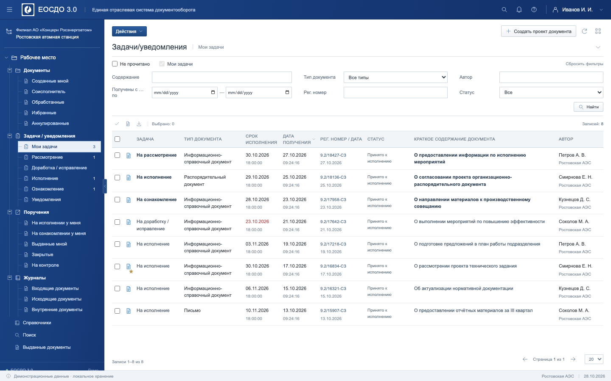

# ЕОСДО 3.0 — интерфейс по видеореференсу

Интерактивный прототип системы электронного документооборота. Повторяет структуру, плотность, сине-серую палитру и основные сценарии из предоставленной записи: дерево разделов, задачи и поручения, карточка документа, создание проекта, номенклатура дел, согласование, связанные документы и поиск.

Все записи демонстрационные. Подключения к реальной ЕОСДО, авторизации, серверной отправки документов и электронной подписи нет. Действия сохраняются только в текущем браузере. Исходное видео, звук и реквизиты реальных документов в Git не включены.



[Карточка документа](docs/document.png)

## Запуск

Нужен Node.js 22.12+ (либо 20.19+).

```sh
npm ci
npm run dev
```

Открыть адрес, напечатанный Vite (обычно http://localhost:5173).

```sh
npm run build       # статические файлы в dist/
npm run preview     # проверка собранного сайта
npm test            # проверки фильтрации, сортировки и хранения
npx playwright install chromium  # один раз для браузерных тестов
npm run test:e2e    # сценарии на desktop и узком экране
```

Содержимое `dist/` можно разместить на статическом хостинге, включая подкаталог. Внешние шрифты, CDN и API не используются.

## Возможности

- Дерево документов, задач, поручений, журналов и поиска.
- Фильтры, период, сортировка, выбор строк, выгрузка CSV.
- Карточка, изменение реквизитов, завершение поручения, избранное.
- Создание проекта, выбор типа и дела из дерева.
- Очереди согласования, участники и локальные визы.
- Связанные документы через поиск или локальную ссылку на карточку.
- Комментарии, история и скачивание демонстрационного файла.
- Сохранение изменений после обновления страницы. Сброс данных — в меню пользователя.

## Устройство

`src/app.js` — интерфейс и действия; `src/data.js` — демонстрационные записи, фильтры и хранилище; `src/styles.css` — оформление; `src/icons.js` — собственные SVG-иконки. Vite нужен для разработки и сборки, Playwright — для браузерной проверки. Прикладных зависимостей нет.

Требования, разбор видео и результаты: [tasks/swiss-clock/video-recreation](tasks/swiss-clock/video-recreation/).
